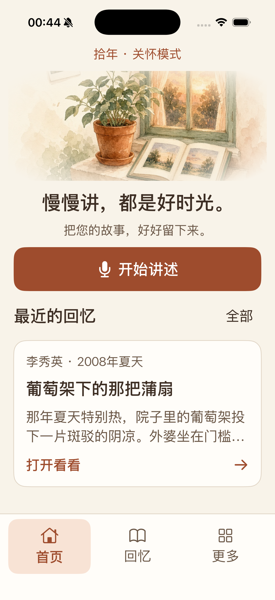
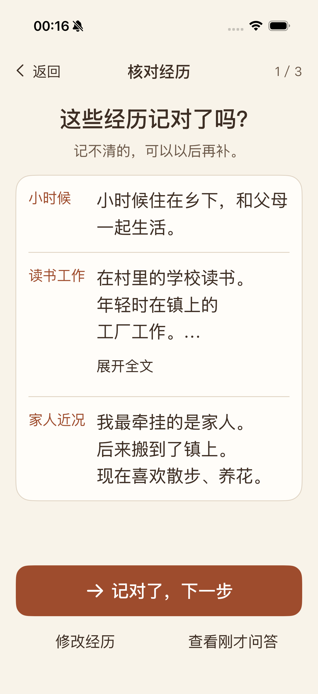
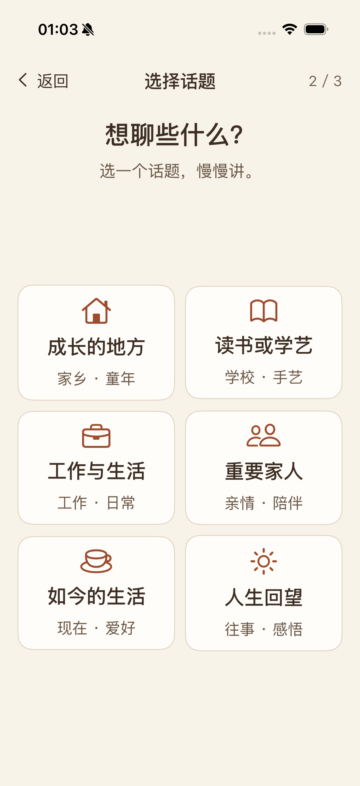
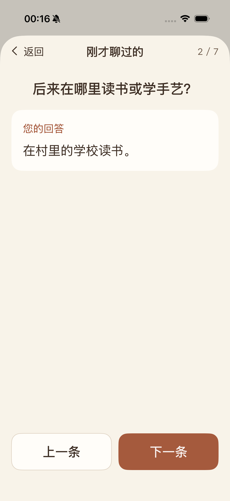
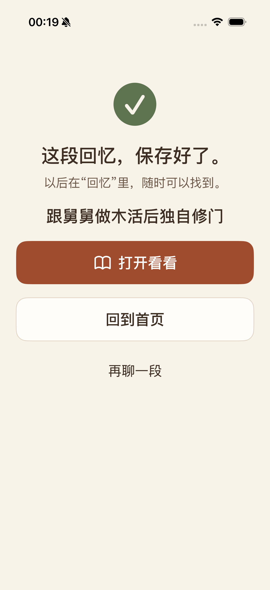
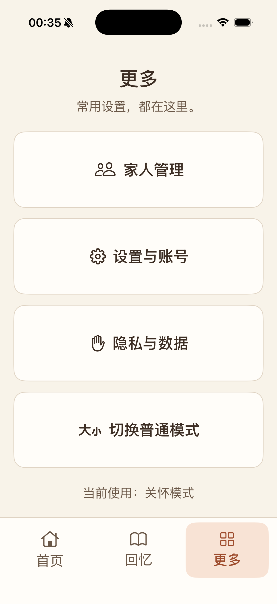
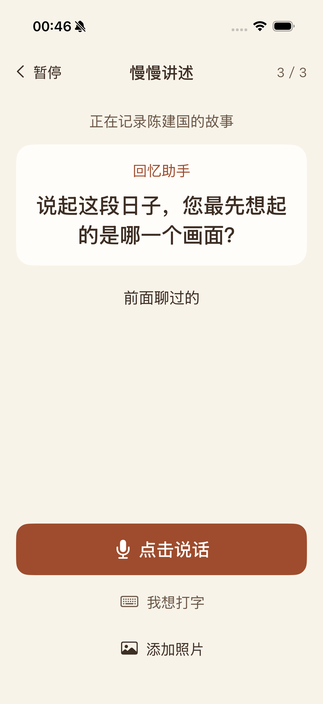

# 老人关怀模式验收记录

日期：2026-10-17。状态：用户已明确批准老人关怀版 UI 和真实后端接入的本提交块，进入正式提交与推送阶段。本次不涉及正式服务发布。

## 本次交付

- 设置中新增「关怀模式」，设备记住选择；普通模式保留四个标签，关怀模式使用首页、回忆、更多三个入口。
- 关怀界面正文 22pt、主要按钮至少 64pt，短标题居中。人生经历集中核对，长内容按需展开；六个话题正常字号两列显示。
- 骨架问答和讲述历史一次查看一组问答。语音点击开始／结束，转写后单独发送；提供打字、收起键盘、照片、跳过和暂停入口。
- 核对经历、选择话题、讲述、草稿修改、保存、完成页和阅读均接入原有业务状态与 API。完成页显示服务端实际保存的回忆，可阅读、回首页或继续讲述。
- 辅助功能字号改为单列和分行导航；大字号／横屏输入区随页面滚动。关怀导航按实际高度布局。

## 实际验证

设备：沿用 iPhone 17 Pro / iOS 26.0（`8801F7F7-7154-4AEB-88F2-1E77A8393190`），Xcode 26.6 / 17F113。未新建、重置或卸载原家庭 App。

| 验证 | 结果 | 证据 |
| --- | --- | --- |
| 当前完整工作区 App 构建 | 通过 | `build-topics-spacing.log` |
| 从 HEAD 独立合入本次增量的 App 构建 | 通过 | `build-topics-review.log`、独立审核源码的 UI 测试构建 |
| 开关持久化、取消／确认恢复普通模式；核对、六话题、逐条历史、编辑草稿、保存、阅读 | 通过 | `CareUI-TopicsLayout.xcresult`（六模块位置修订后复测通过） |
| 系统最大辅助功能字号、问答翻页、横屏导航 | 通过 | `CareUI-Acceptance.xcresult` |
| 最大字号下打字、收起键盘、滚动到发送并发送 | 通过 | `CareUI-Keyboard.xcresult` |
| 首次语音授权拒绝后的提示与打字发送 | 通过 | `CareUI-VoicePermission.xcresult` |
| 阿里云注册独立家庭、添加家人、人生概览、工作模块、讲述、生成、保存、阅读、重启回看 | 通过 | `CareUI-Acceptance.xcresult` 的云端测试 |

测试中的中断已处理：SSH 转发断开后恢复；Debug 草稿编辑适配器补齐带时间的协议方法；标题编辑测试修正光标位置；添加家人补齐键盘完成操作；最大字号输入增加明确的「收起键盘」入口后复测通过；修复系统语音授权框触发 inactive 时误取消准备的问题，重置测试 App 权限并重新拒绝授权、打字发送通过。早期失败记录保留，不能当作通过证据。

阿里云候选为 `shinian-care-isolated`，使用现有已发布镜像、独立数据库和媒体目录，仅绑定服务器 `127.0.0.1:18009`，通过临时 SSH 转发联调。健康检查 `status=ok`、`database=ok`、`llm_configured=true`。候选测试未写入真实家庭，未变更正式服务。联调完成后已关闭本机临时 SSH 转发；候选保留用于本块复核。

模拟器云端写入使用独立 bundle `com.yourname.AIMemoirs.carevalidation`。权限拒绝验证仅作用于该测试 App。语音拒绝和键盘回退已列入验证；本次未将模拟器验证表述为真机收音及实际转写质量验收。

## 截图

截图来自真实 SwiftUI App。预览样例及云端测试故事均为合成数据。最终构建已覆盖安装到原 App，保留原家庭登录和关怀偏好；完成截图后以正常联网方式重新打开。

| 核对经历 | 六个话题 |
| --- | --- |
|  |  |

| 逐条回看 | 云端保存完成 |
| --- | --- |
|  |  |

## 复核方法

1. 在普通模式打开「我的 → 设置 → 关怀模式」，开启后返回首页；重新打开 App 检查偏好仍保留。
2. 点「开始讲述」，选家人；未完成的人生问答会逐题展示。已有概览则核对经历、按需展开或修改，再选择话题。
3. 讲述后整理草稿，修改标题或正文，再保存。核对完成页标题和阅读内容；回到首页、重启后从回忆打开。
4. 在「更多 → 切换普通模式」分别取消、确认，检查恢复原有普通版。
5. 在模拟器辅助功能最大字号下检查逐条回看、滚动输入和「收起键盘 → 发送」。本次重启、云端写入及权限操作的自动测试仅使用独立测试 App。

## 更多页留白修订

用户在 00:32 反馈“下方别留那么多空白”。更多页现根据可用屏幕高度分配四个按钮的最小高度，普通字号下填补原先集中在底部的空白，保留正常的边距。辅助功能字号使用原有最小按钮高度，由文字自然撑开并保留滚动容器。

当前工作区与独立审核源码构建均通过，已在原 iPhone 17 Pro 安装并核对普通字号和最大字号的实际画面。正常字号下四个入口、模式说明与底部导航同屏显示。本次只调整本地排版，云端业务沿用上方已完成的联调结果。

## 首页插画与留白修订

用户随后要求首页同样减少底部空白，并复用普通版首页图片。现使用已有 `JournalWelcome` 窗边相册水彩插画，按“模式说明 → 插画 → 标题与说明 → 开始讲述 → 最近回忆”排列，缩紧段间距。首页回忆卡片保留姓名、时间、标题、摘要与打开入口；回忆照片仍可在回忆列表和详情查看。

当前完整工作区和独立审核源码均构建通过（`build-home-layout.log`、`build-home-review.log`）。已在现有 iPhone 17 Pro 安装并使用原家庭数据核对：正常字号下插画、主按钮、最近回忆和底部导航同屏显示；未向家庭写入验证内容。上方首页截图已更新为同一真实界面下的合成样例，避免将私人回忆写入仓库。此修订为本地排版，沿用已完成的云端业务联调结果。

## 讲述页入口精简

按用户反馈移除关怀模式讲述页中的“查看人生经历或换话题”按钮，保留“前面聊过的”。普通版人生概览入口和首次人生问答后的核对、选话题步骤沿用现有行为。

当前工作区构建通过（`build-remove-topic-entry.log`）。使用独立审核源码回归讲述、草稿编辑、保存阅读及取消／确认模式切换通过；结果与截图见 `CareUI-SimplifiedNarration.xcresult`。

## 六个模块纵向位置修订

用户要求六个模块自然下移，同时保留按钮大小。选题页现按可用屏幕高度均衡分配标题与模块之间、模块下方的余量，整体下移六个模块；保留原有卡片尺寸、字号和网格间距。辅助功能字号沿用单列自然滚动。

当前工作区与独立审核源码构建通过（`build-topics-spacing.log`、`build-topics-review.log`）。原 iPhone 17 Pro 已安装并核对排版；六模块全部可直接点击，选题后讲述、草稿编辑、保存阅读与模式切换回归通过，记录见 `CareUI-TopicsLayout.xcresult`。上方六个话题截图已更新。

## 审核范围与产物

提交主题：`feat(care): 新增关怀模式并接入真实回忆流程`。审核范围为关怀组件、现有视图的关怀展示分支、设备偏好、Debug 适配器、关怀 UI 测试及本目录。

仓库另有开发前已存在的后端、聊天、回忆录、工程配置及文档修改。本次以开发前 Swift 快照为基线制作增量，三方合入 HEAD 得到独立审核源码并完成构建／流程验证；这些既有改动不属于本次提交。

完整本机产物位于 `/Users/student03/Desktop/shinian-validation/artifacts/senior-care-20261016/`，包括基线、`review-source/`、`implementation.patch`、构建日志及各次 `.xcresult`。凭据不写入仓库。实际审阅时应以本次增量补丁和上述验收记录为准。

用户于 2026-10-17 明确批准老人关怀版 UI 和真实后端接入全部 commit；按 project-development 约定正式提交本块并推送 `main`。
